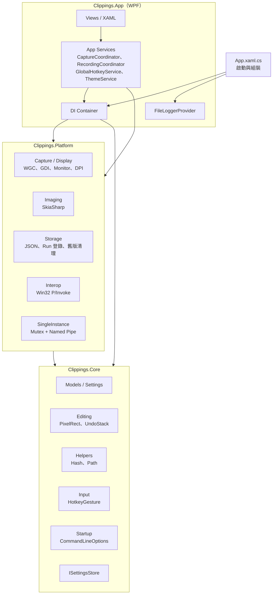
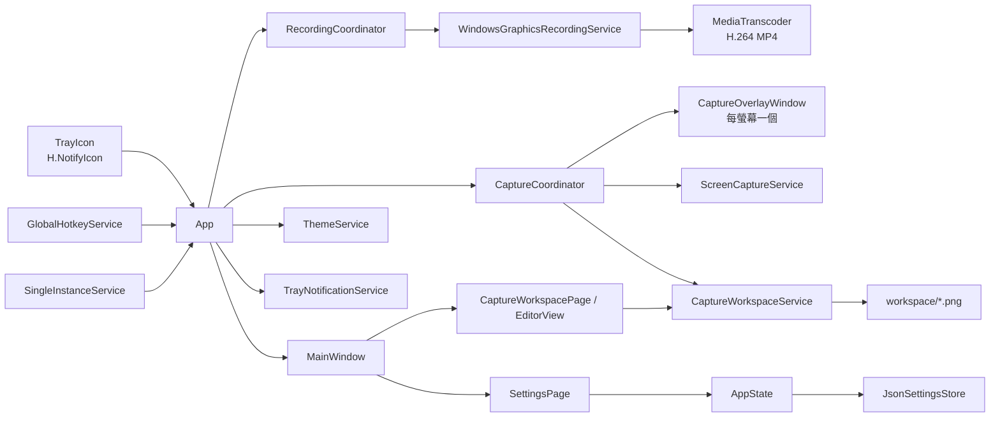
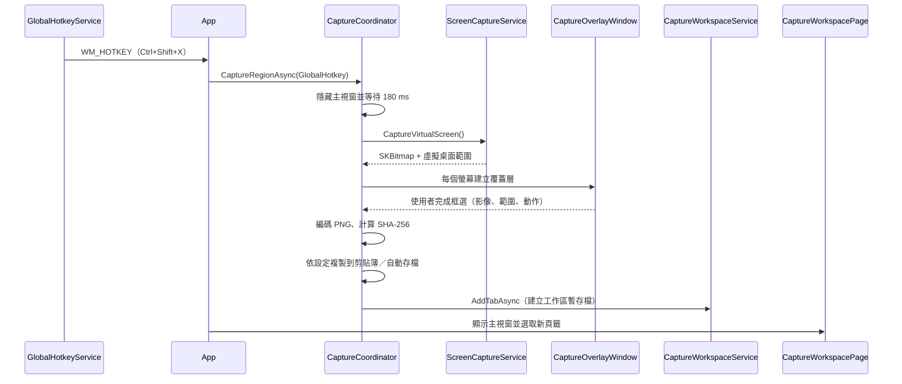
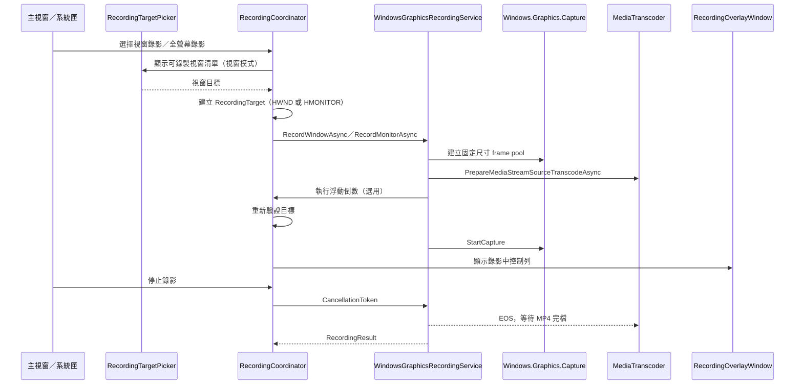
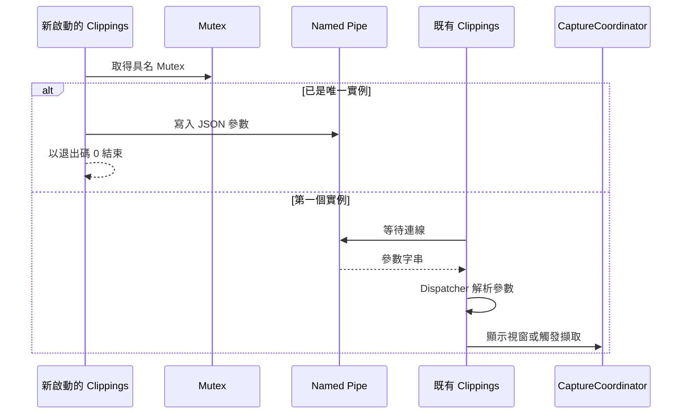
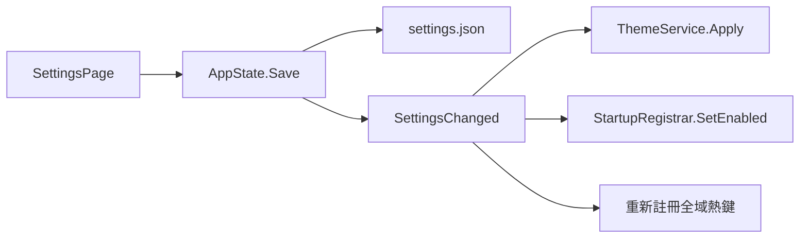
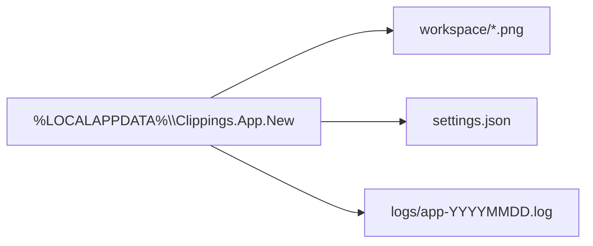

# 系統架構

本文件說明 Clippings 的整體架構、分層責任、執行時元件、主要資料流與執行緒模型。實作細節請搭配 [技術文件](TECHNICAL.md) 與 [系統設計](SYSTEM_DESIGN.md) 閱讀。

---

## 1. 架構目標

- **離線、免安裝**：不依賴雲端服務，self-contained 發佈即可執行。
- **低介入常駐**：以系統匣常駐，全域快捷鍵隨時可用。
- **可測試的核心**：與 UI、Win32 無關的邏輯放在 `Clippings.Core`，可用 xUnit 測試。
- **清楚的平台邊界**：Win32、SkiaSharp 等平台相依程式碼集中在 `Clippings.Platform`。
- **單一實例**：重複啟動不產生第二個常駐程式，命令列參數會轉送給既有實例。

---

## 2. 分層架構



### 專案責任

| 專案 | 目標框架 | 責任 |
| --- | --- | --- |
| `Clippings.Core` | `net10.0-windows10.0.19041.0` | 純資料模型、設定、`PixelRect`、`UndoStack`、雜湊、路徑、快捷鍵格式、命令列解析、儲存介面 |
| `Clippings.Platform` | 同上 | Windows.Graphics.Capture／GDI 螢幕擷取、螢幕列舉與 DPI、SkiaSharp 編碼、JSON 設定、開機登錄、單一實例管線、主控台附加 |
| `Clippings.App` | 同上（`UseWPF`） | WPF 視窗與頁面、DI 容器、系統匣、擷取協調、全域熱鍵、主題、日誌 |
| `Clippings.Core.Tests` | 同上 | `Core` 的單元測試（xUnit） |

依賴方向固定為：

```
Clippings.App ──► Clippings.Platform ──► Clippings.Core
      └──────────────────────────────────►
```

`Core` 不參考 `Platform` 或 `App`；`Platform` 不參考 `App`。

---

## 3. 執行時元件



| 元件 | 生命週期 | 主要職責 |
| --- | --- | --- |
| `App` | 整個程式 | 解析命令列、建立 Host、初始化系統匣與服務、處理單一實例轉送 |
| `MainWindow` | 單例，可隱藏 | 兩頁導覽、錄影控制與計時、完成檔案操作、關閉時縮到系統匣 |
| `CaptureWorkspacePage` | 首次導覽時建立 | 擷圖頁籤、頁籤上限、關閉／全部關閉與 6 秒吐司復原、另存新檔與自動暫存 |
| `EditorView` | 每個工作區頁面一個 | 內嵌編輯器：標註、裁切、旋轉／翻轉、復原／重做、複製 |
| `SettingsPage` | 首次導覽時建立 | 設定編輯、快捷鍵錄製、錄影輸出選項、儲存 |
| `CaptureWorkspaceService` | 單例 | 管理頁籤清單、工作區暫存檔、20 個頁籤上限與序號化 I/O |
| `CaptureCoordinator` | 單例 | 協調擷取流程、覆蓋層、複製、自動存檔與建立擷圖頁籤 |
| `RecordingCoordinator` | 單例 | 管理視窗／螢幕錄影、準備／倒數／錄影／暫停狀態、開始／停止、輸出路徑與通知 |
| `RecordingTargetPicker` | 單例 | 顯示可錄製視窗清單並回傳使用者選定的視窗 |
| `RecordingCountdownService` | 單例 | 在目標中央顯示不搶焦點且排除擷取的浮動倒數 |
| `RecordingOverlayService` | 單例 | 管理錄影中控制列，顯示時間、目標名稱與暫停／繼續／停止 |
| `RecordingOverlayWindow` | 每次錄影 | 目標螢幕右上角的浮動控制列 |
| `RecordingControl` | 每次錄影 | 可暫停計時器與 sample request 暫停 gate |
| `WindowsGraphicsRecordingService` | 每次錄影建立內部 session | WGC frame、latest-frame slot、MediaStreamSource、H.264 MP4 完檔 |
| `CaptureOverlayWindow` | 每次框選 | 凍結畫面、框選、放大鏡、浮動操作列 |
| `GlobalHotkeyService` | 單例 | `RegisterHotKey`、訊息視窗、快捷鍵分派 |
| `ThemeService` | 單例 | 切換資源字典與標題列深色模式 |
| `SingleInstanceService` | 單例 | Mutex 判斷、Named Pipe 轉送啟動參數 |

---

## 4. 主要流程

### 4.1 區域擷取



重點：

- 主視窗可見時才先隱藏，避免拍到自身；未顯示時不等待隱藏動畫。
- 先擷取整個虛擬桌面，再依螢幕裁切成各自的覆蓋層影像，確保框選時畫面靜止。
- 完成後先複製到剪貼簿，再於背景執行 PNG 編碼並建立工作區頁籤；擷取歷史資料庫不再寫入。

### 4.2 全螢幕、目前螢幕與目前視窗

| 模式 | 擷取來源 | 後續動作 |
| --- | --- | --- |
| 全螢幕 | 所有螢幕的聯集 | 複製／暫存後建立頁籤；非 CLI 來源會顯示主視窗並選取新頁籤 |
| 目前螢幕 | 游標所在螢幕 | 裁切後複製／暫存並建立頁籤 |
| 目前視窗 | Windows.Graphics.Capture；不可用時退回前景視窗可見邊界（DWM 擴充框） | 與目前螢幕相同 |
| 延遲 | 倒數後改走區域框選 | 與區域擷取相同 |

### 4.3 螢幕錄影



錄影維持固定輸出尺寸；目標關閉或尺寸改變會送出 EOS。暫停時 sample request 會暫停，時間軸不前進。暫存檔完成封裝後才改名為 MP4，不寫入圖片歷史資料庫。

### 4.4 單一實例與命令列轉送



### 4.5 設定變更



---

## 5. 執行緒模型

| 工作 | 執行位置 | 說明 |
| --- | --- | --- |
| UI 操作、視窗生命週期 | WPF Dispatcher | 所有 WPF 控制項只能在此執行緒存取 |
| 螢幕擷取（GDI `BitBlt`） | `Task.Run` | 避免阻塞 UI |
| 視窗擷取（Windows.Graphics.Capture） | free-threaded frame pool | 首幀複製完成後轉為 `SKBitmap` |
| 螢幕錄影 frame | free-threaded frame pool | latest-frame slot；未送出的舊 frame 立即丟棄 |
| H.264 MP4 編碼 | MediaStreamSource／MediaTranscoder | GPU surface 樣本、正常 EOS 完檔 |
| 影像編碼、縮圖、解碼 | `Task.Run` | SkiaSharp 操作 |
| 日誌寫入 | 背景 Channel 消費者 | 不阻塞呼叫端，保留 7 天 |
| Named Pipe 監聽 | 背景 `Task` | 收到後以 `Dispatcher.BeginInvoke` 切回 UI |
| 全域熱鍵與前景視窗 | 訊息視窗／WinEvent Hook | 由 Windows 訊息迴圈驅動 |

`CaptureCoordinator` 以 `_busy` 旗標避免重入；忙碌時新的擷取請求會被忽略。

---

## 6. 資料架構



- `workspace/*.png`：擷圖頁籤的自動暫存檔，關閉頁籤後保留 6 秒供吐司復原，逾時或另存新檔後刪除。
- 舊版 `clippings.db` 不再開啟；啟動時僅清理已停用的剪貼簿歷史目錄與縮圖。

---

## 7. 錯誤處理與日誌

- 服務層以 `try/catch` 包裹可預期的 I/O 與平台錯誤，記錄後以系統匣通知或對話框告知使用者。
- UI 執行緒、背景執行緒與未觀察的工作例外都有全域處理常式。
- 日誌使用 `Microsoft.Extensions.Logging`，輸出到 `%LOCALAPPDATA%\Clippings.App.New\logs`，保留 7 天。
- 正式版不輸出主控台日誌；`--help` 與命令列錯誤才會附加父主控台。

---

## 8. 安全與隱私

- 程式沒有任何網路呼叫，也不會上傳截圖或日誌。
- 所有資料位於目前使用者的 `%LOCALAPPDATA%`，受 Windows 使用者權限保護。
- 受保護內容（DRM、獨佔全螢幕）可能無法擷取。
- 詳細說明見 [隱私說明](PRIVACY.md)。

---

## 9. 部署與版本

- 目標框架：`net10.0-windows10.0.19041.0`，最低支援 Windows 10 1809。
- 平台：x64。
- 發佈：win-x64，提供兩種版本：
  - 完整免安裝版：self-contained + ReadyToRun，不需要 .NET。
  - 精簡版：framework-dependent、關閉 ReadyToRun，需 .NET 10 Desktop Runtime。
- 版本集中於 `Directory.Build.props`；`Version` 採 `主.次.修`，`AssemblyVersion` 僅在主次版變更時調整。
- 詳細流程見 [建置與發佈](BUILD_AND_RELEASE.md)。

---

## 10. 設計限制

- 區域、全螢幕與螢幕擷取仍使用 GDI `BitBlt`；Windows.Graphics.Capture 目前僅用於目前視窗的單張擷取。
- 框選一次僅限單一螢幕。
- 混合 DPI 多螢幕僅以 100% 縮放實測。
- 介面文字尚未外部化為 `.resw`／`.resx`。
- WPF 與 WinUI 3 的控制項不可混用；本專案選擇 WPF 的決策記錄於 [開發紀錄](DEV_LOG.md)。
