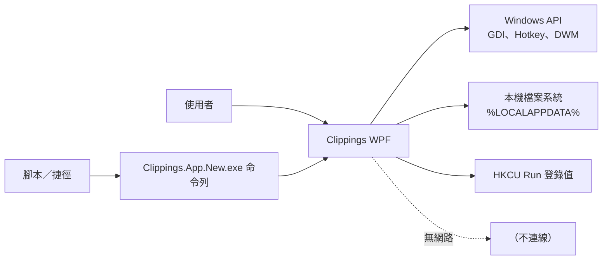
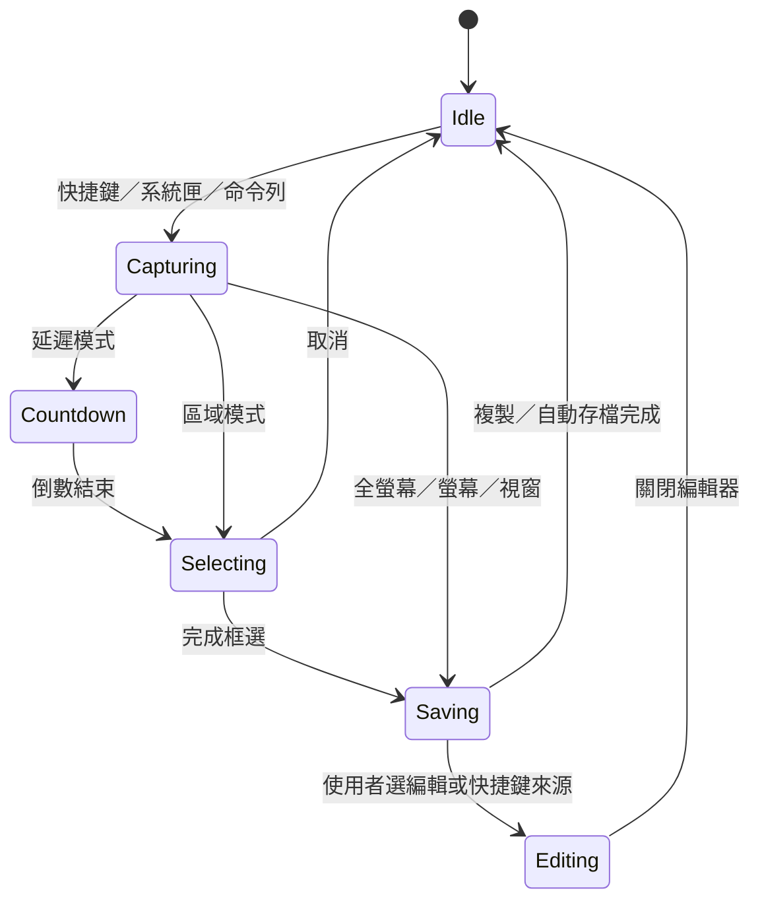
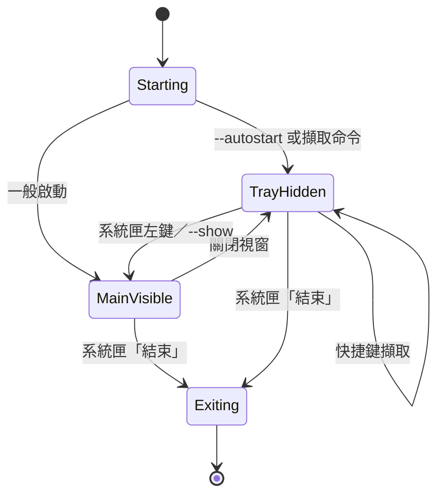

# 系統設計文件

本文件說明 Clippings 的設計目標、需求、模組責任、關鍵決策與取捨。若需要程式碼層級細節，請見 [技術文件](TECHNICAL.md)；若需要元件與資料流圖，請見 [系統架構](ARCHITECTURE.md)。

---

## 1. 範圍

Clippings 是一個 Windows 單機桌面應用程式，提供：

- 多種模式的螢幕擷取。
- 框選與標註編輯。
- 擷圖頁籤工作區。
- 系統匣常駐、全域快捷鍵、開機啟動與單一實例。
- 最小命令列介面。

本文件不涵蓋雲端同步、多人協作、行動裝置版本或影像辨識等未實作功能。

---

## 2. 設計目標

| 目標 | 說明 |
| --- | --- |
| 快速 | 從按下快捷鍵到可框選的時間要短，不打斷原本工作流程 |
| 直覺 | 框選後直接進入編輯器，複製與儲存設定集中處理 |
| 可靠 | 擷取失敗要有提示，資料寫入失敗不能讓程式崩潰 |
| 隱私 | 所有資料留在本機，無網路功能 |
| 可攜 | 免安裝、self-contained，資料集中在單一資料夾 |
| 可維護 | Core 與平台／UI 分離，核心邏輯可單元測試 |

### 非目標

- 取代專業影像編輯器。
- 提供雲端備份或跨裝置同步。
- 支援 Windows 10 1809 以前的版本。
- 支援 ARM64 或 32 位元 Windows。
- 完整錄影功能（螢幕／區域、音訊、暫停、影片編輯）、滾動長截圖、OCR。

---

## 3. 使用情境

| 編號 | 情境 | 主要流程 |
| --- | --- | --- |
| UC-01 | 快速截取畫面片段 | 快捷鍵 → 框選 → 複製或編輯 |
| UC-02 | 截取整個畫面或指定螢幕 | 快捷鍵／系統匣／命令列 → 直接儲存與複製 |
| UC-03 | 截取目前視窗 | 快捷鍵 → 取得前景視窗邊界 → 擷取 |
| UC-04 | 延遲截取開啟中的選單 | 快捷鍵 → 倒數 → 框選 |
| UC-05 | 在截圖上標註 | 擷圖頁籤 → 箭頭／文字／馬賽克 → 複製或另存新檔 |
| UC-06 | 找回稍早的截圖 | 主視窗 → 擷圖頁籤 → 切換／編輯／關閉 |
| UC-07 | 由腳本觸發擷取 | 命令列參數 → 轉送既有實例 → 擷取 |
| UC-08 | 開機後自動常駐 | `--autostart` → 隱藏主視窗 → 註冊快捷鍵 |
| UC-09 | 錄製目前視窗 | 系統匣開始 → WGC 擷取 → 系統匣停止／目標改變 → 無聲 MP4 |

---

## 4. 需求

### 4.1 功能需求

| 編號 | 需求 | 對應實作 |
| --- | --- | --- |
| FR-01 | 全域快捷鍵可觸發區域、全螢幕、視窗、延遲擷取 | `GlobalHotkeyService`、`CaptureCoordinator` |
| FR-02 | 快捷鍵可在設定頁修改並即時重新註冊 | `SettingsPage`、`App.ApplyHotkeys` |
| FR-03 | 區域擷取需先凍結畫面，支援移動與調整選取範圍 | `CaptureOverlayWindow` |
| FR-04 | 框選時顯示放大鏡、座標、RGB 與尺寸 | `CaptureOverlayWindow` |
| FR-05 | 提供確定、取消兩種框選完成動作 | `OverlayAction` |
| FR-06 | 編輯器支援多種標註工具、16 色與線寬 | `EditorView`、`Annotation` |
| FR-07 | 編輯器支援復原、重做、可取消的裁切與旋轉／翻轉 | `UndoStack`、`EditorSnapshot`、`ImageCodec` |
| FR-08 | 每次擷取建立頁籤並自動暫存，最多 20 個；可逐一或全部關閉，不確認；6 秒吐司可復原，逾時才刪除暫存 | `CaptureWorkspaceService`、`CaptureWorkspacePage` |
| FR-09 | 支援 PNG／JPEG 輸出與 JPEG 品質調整 | `ImageCodec`、`AppSettings` |
| FR-10 | 系統匣常駐、右鍵選單、關閉視窗不結束程式 | `App`、`TaskbarIcon` |
| FR-11 | 單一實例，重複啟動可喚出既有視窗 | `SingleInstanceService` |
| FR-12 | 支援開機啟動且不顯示主視窗 | `StartupRegistrar`、`--autostart` |
| FR-13 | 支援最小命令列參數與退出碼 | `CommandLineOptions`、`App` |
| FR-14 | 提供九種介面主題 | `ThemeService`、`Styles/*.xaml` |
| FR-15 | 編輯結果自動暫存，重新啟動可還原；另存新檔後刪除暫存並保留頁籤 | `CaptureWorkspacePage`、`CaptureWorkspaceService` |
| FR-16 | 從主視窗或系統匣選擇視窗或目前螢幕錄影，設定 FPS／位元率／游標／延遲／資料夾並輸出無聲 H.264 MP4；錄影中可暫停、繼續、停止 | `RecordingCoordinator`、`RecordingOverlayService`、`WindowsGraphicsRecordingService`、`SettingsPage` |
| FR-17 | 使用獨立 APP ID `Clippings.App.New` 與資料夾，可與舊版並存 | `AssemblyName`、`PathUtil`、`SingleInstanceService`、`StartupRegistrar`、`AppIdentity` |

### 4.2 非功能需求

| 類別 | 要求 |
| --- | --- |
| 效能 | 一般 1080p 螢幕的擷取與編碼不應讓 UI 明顯凍結；影像工作在背景執行緒 |
| 可靠性 | I/O 失敗不可導致崩潰；設定檔損壞時回到預設值 |
| 隱私 | 無網路連線、無遙測；資料只存本機 |
| 相容性 | Windows 10 1809 以上、x64 |
| 可及性 | 可點擊圖示按鈕提供 `AutomationProperties.Name` 與 ToolTip |
| 可維護性 | Core 不依賴 UI／Win32；核心邏輯有單元測試 |
| 可攜性 | 提供 self-contained 免安裝版與 framework-dependent 精簡版，資料集中於 `%LOCALAPPDATA%\Clippings.App.New` |

---

## 5. 系統邊界

系統只與 Windows 本機 API 和檔案系統互動，沒有伺服器端元件。

---

## 6. 模組設計

| 模組 | 責任 | 不負責 |
| --- | --- | --- |
| Core.Models | 資料結構與設定 | I/O、UI |
| Core.Editing | 幾何與復原堆疊 | 實際繪圖 |
| Core.Input | 快捷鍵格式解析 | 註冊熱鍵 |
| Core.Startup | 命令列解析 | 啟動流程 |
| Platform.Capture | 螢幕像素取得 | 框選 UI |
| Platform.Imaging | 編碼、解碼、縮圖、裁切、旋轉／翻轉 | 標註合成 |
| Platform.Storage | 檔案、設定、登錄、舊版清理 | 商業流程 |
| Platform.SingleInstance | Mutex 與管線轉送 | 參數解讀 |
| App.Services | 流程協調、監聽、熱鍵、主題 | 平台細節 |
| App.Views | 視窗、頁面、互動 | 資料持久化 |

---

## 7. 關鍵設計決策

### 7.1 WPF 而非 WinUI 3

- 本專案依使用者決定採用 WPF。
- 優點：成熟、SkiaSharp 有現成 WPF 控制項、`H.NotifyIcon` 系統匣支援完整。
- 缺點：Fluent 視覺需自行以樣式模擬，沒有 WinUI 的原生 NavigationView。
- 決策記錄於 `docs/DEV_LOG.md`。

### 7.2 GDI `BitBlt` 搭配 Windows.Graphics.Capture

- 區域、全螢幕與螢幕擷取維持 GDI，保留高相容性與直接取得虛擬桌面的能力。
- 目前視窗在 Windows 10 1903 以上優先使用 Windows.Graphics.Capture，補強被其他視窗遮擋的情境。
- Windows.Graphics.Capture 不支援或失敗時自動退回 GDI，不提高應用程式的最低 Windows 版本。

### 7.3 暫存檔而非資料庫

- 擷圖頁籤以 `workspace\*.png` 檔案暫存，避免資料庫膨脹與備份困難。
- 關閉頁籤後保留 6 秒供吐司復原，逾時或另存新檔後刪除。
- 舊版 `clippings.db` 不再開啟或寫入。

### 7.4 JSON 設定而非資料庫

- 設定項目少、需要人工檢視與備份。
- 使用暫存檔 + 原子搬移降低損壞風險。
- 損壞時回到預設值，不阻止程式啟動。

### 7.5 單一實例使用 Mutex + Named Pipe

- Mutex 判斷是否已有實例。
- Named Pipe 轉送參數，讓第二次啟動能觸發既有實例。
- JSON 單行訊息方便擴充，並以 1024 bytes 上限避免惡意過長內容。

### 7.6 標註以資料模型保存

- 工具列操作只新增 `Annotation`，不直接修改像素。
- 復原／重做以快照實作，裁切與旋轉／翻轉才真正改變底圖。
- 輸出時一次合成，方便維持品質與簡化互動。

### 7.7 命令列採「轉送」而非第二個常駐程式

- 保持單一實例與一致的資料狀態。
- 第二實例只負責轉送並結束，退出碼代表轉送結果。

---

## 8. 狀態與生命週期

### 8.1 擷取狀態

- 同一時間只允許一個擷取流程；忙碌時新請求會被忽略。
- 失敗時顯示提示並回到 `Idle`。

### 8.2 應用程式狀態

`ShutdownMode` 設為 `OnExplicitShutdown`，因此關閉主視窗只會隱藏，不會結束程式。

---

## 9. 錯誤處理策略

| 情境 | 處理方式 |
| --- | --- |
| 快捷鍵被佔用 | 記錄警告、系統匣通知、設定頁顯示失敗清單 |
| 螢幕擷取失敗 | 對話框提示，流程回到閒置 |
| 找不到前景視窗 | 拋出可預期例外，提示使用者 |
| 工作區暫存失敗 | 記錄錯誤、系統匣通知；已完成的影像仍可複製與自動存檔 |
| 自動存檔失敗 | 記錄警告、通知；不影響擷圖頁籤 |
| 設定檔損壞 | 回到預設設定，不阻止啟動 |
| 命令列參數錯誤 | 輸出用法並以退出碼 2 結束 |
| 單一實例轉送失敗 | 輸出錯誤並以退出碼 1 結束 |
| 未處理例外 | 寫入日誌；UI 例外顯示對話框 |

---

## 10. 資料保留與一致性

- 擷圖頁籤暫存檔在編輯後自動更新；關閉頁籤後保留 6 秒供吐司復原，逾時或另存新檔後刪除。

---

## 11. 安全與隱私

- 無網路功能、無遙測、無帳號。
- 日誌只保留 7 天，不含圖片內容（除非例外訊息本身包含）。
- 擷取結果可能包含敏感資訊，使用者應自行管理 `%LOCALAPPDATA%\Clippings.App.New` 與自動存檔資料夾。
- 開機啟動只寫入目前使用者的 `HKCU`，不需要系統管理員權限。

---

## 12. 測試策略

| 層級 | 方式 |
| --- | --- |
| Core | xUnit 單元測試：快捷鍵、幾何、復原堆疊、設定、雜湊、命令列 |
| Platform | 以手動或整合測試驗證 Windows.Graphics.Capture、GDI、管線 |
| UI | 手動操作驗證框選、編輯器、設定、系統匣 |
| 建置 | `dotnet build`、`dotnet test`、`dotnet format --verify-no-changes` |

目前沒有自動化 UI 測試與實際螢幕擷取測試，這是後續可改善之處。

---

## 13. 風險與限制

| 風險 | 影響 | 緩解 |
| --- | --- | --- |
| WGC／GDI 擷取受 DRM、獨佔全螢幕或 GPU 環境影響 | 黑畫面、空白或失敗 | WGC 失敗自動退回 GDI；文件說明仍無法擷取的限制 |
| 混合 DPI 多螢幕 | 框選位置誤差 | 目前僅以 100% 實測；需補齊驗證 |
| 全螢幕擷取記憶體用量 | 多 4K 螢幕可能佔用大量記憶體 | 完成後立即釋放；縮圖降低長期成本 |
| 系統匣圖示快取 | 舊圖示顯示 | 文件提供重新固定步驟 |
| 無自動化 UI 測試 | 回歸風險 | 以 Core 測試與手動清單補強 |

---

## 14. 後續規劃

- 擴充錄影至整個螢幕／區域、音訊、暫停與 GPU 固定畫布縮放。
- 跨螢幕框選。
- 滾動長截圖。
- 多語系資源檔（`.resx`）。
- 自動化 UI 測試與擷取整合測試。
- 命令列 `--wait` 或輸出路徑，讓腳本能取得完成結果。
- 混合 DPI 多螢幕實測與修正。
